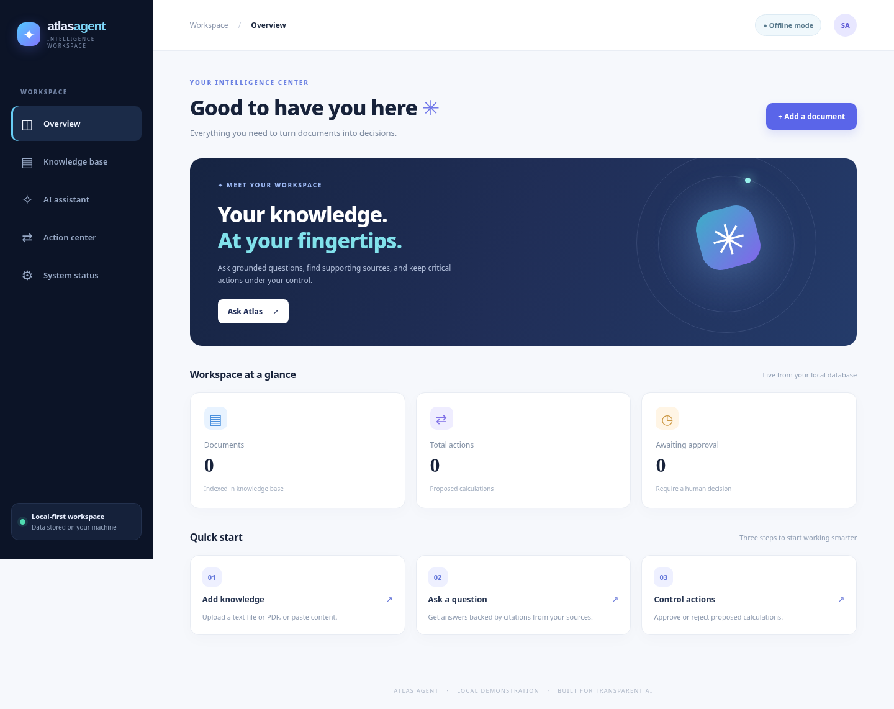
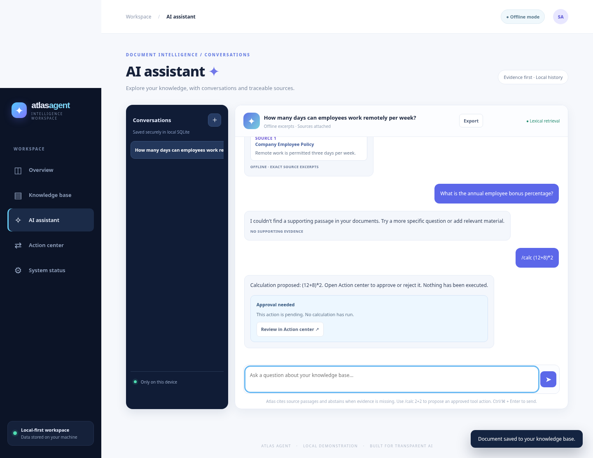
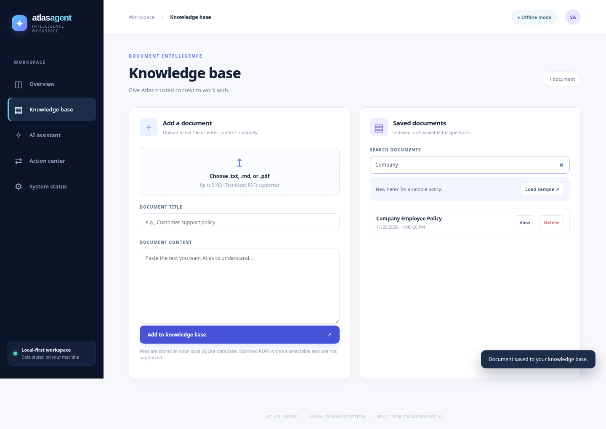
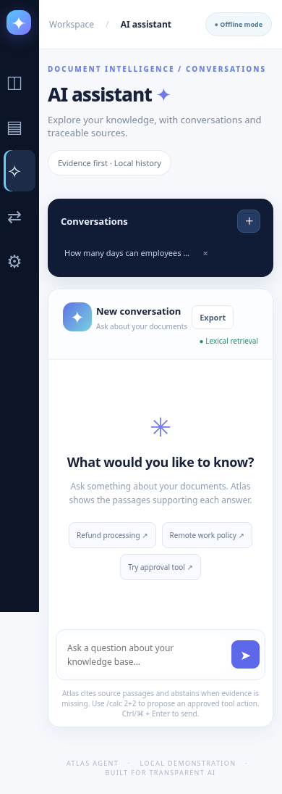
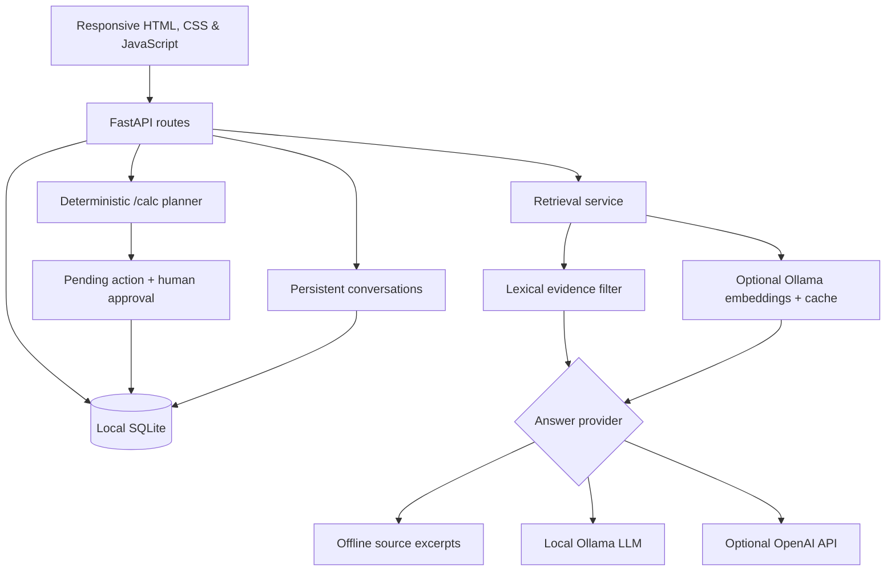

# ✦ Atlas Agent — A Local-First AI Knowledge Workspace

**An interview-ready, single-user application for document Q&A, saved conversations, source inspection and human-approved tool actions.** Built with **Python, FastAPI, SQLite and vanilla JavaScript**, plus optional local AI via Ollama.



Python 3.11+ · MIT License · GitHub Actions CI included · Local-first, no SaaS subscription required.

> Screenshots below were captured from the actual interface using a headless browser and an in-process API adapter, not from a design mockup.

## Engineering case study

### The problem

Teams have knowledge scattered across text files and policies. Keyword-only search can return misleading answers, and AI-generated replies can appear confident even without evidence. Automated actions may also execute without meaningful human oversight.

### The solution

Atlas provides a focused workspace for importing documents, asking questions, and inspecting the sources behind each answer. By default it performs conservative local retrieval and shows *exact source excerpts*. It can optionally use a local Ollama model for semantic embeddings and concise source-grounded generation. If there is no sufficient evidence, it abstains. A constrained `/calc` chat command demonstrates tool planning while leaving execution behind an explicit approval gate.

### What it demonstrates

| Capability | Engineering evidence |
|---|---|
| Document processing | TXT, Markdown, text PDFs; file/type/size validation; SQLite storage |
| Retrieval | Conservative lexical matching, numeric-question safeguards, optional semantic embeddings with cached vectors |
| Answer generation | Ollama (free/local) or optional OpenAI; citations required, numeric guard and extractive fallback |
| Persistent history | Create, reopen, delete and export conversations; messages retain source snapshots |
| Human-in-the-loop tools | `/calc <expression>` proposes an arithmetic action; approvals and rejections are recorded |
| Frontend UX | Responsive dashboard, document filtering, source viewer, chat history, system status, accessible controls |
| Quality | 41 automated Python tests, JavaScript syntax check, GitHub Actions, browser smoke testing |
| Security boundaries | Parameterized SQL, AST arithmetic, safe DOM rendering, browser origin and Host safeguards |

### Interface screenshots

| AI Assistant | Document workspace |
|---|---|
|  |  |



## One-time installation on Windows

**1. Extract** the release ZIP. Open the inner **`atlas-agent`** folder in VS Code. The correct folder contains `requirements.txt`, `app`, `web`, `tests` and `README.md` at the same level.

**2. In a PowerShell terminal inside that exact folder**, run:

```powershell
py -m venv .venv
.\.venv\Scripts\python.exe -m pip install -r requirements.txt
```

No `Activate.ps1` is required. This avoids PowerShell execution-policy issues.

**3. If you want to preserve your existing Atlas documents and conversations**, migrate your previous database *before starting the new application*:

```powershell
.\.venv\Scripts\python.exe scripts\migrate_db.py --from "C:\path\to\OLD\atlas-agent\atlas.sqlite"
```

Replace the example `--from` path with the **real** `atlas.sqlite` in your older Atlas project. The migration uses SQLite's backup API, preserves the old database, verifies integrity, and refuses to overwrite any existing destination. If the source database is absent or you want a fresh workspace, **skip this step**. See [Migration guide](docs/MIGRATION.md).

**4. Start the app:**

```powershell
.\.venv\Scripts\python.exe -m uvicorn app.main:app --host 127.0.0.1 --port 8001
```

Open **http://127.0.0.1:8001**. The default mode needs **no API key, npm, or Ollama**. Keep the terminal open. Stop the app with `Ctrl+C`.

**5. When we're ready to test the full release**, run this once:

```powershell
.\.venv\Scripts\python.exe -m pytest -q
```

Then use [Final acceptance test plan](docs/TEST_PLAN.md) to test each feature systematically. There is no need to replace files between tests.

## Optional AI configurations

The application is **fully usable offline**, but offline mode returns exact supporting excerpts rather than generated prose. To get local conversational answers and semantic search, install [Ollama](https://ollama.com/download), then pull the models:

```powershell
ollama pull llama3.2:3b
ollama pull nomic-embed-text
```

Ensure Ollama is running, then in the PowerShell session from which Atlas will be started:

```powershell
$env:ATLAS_AI_PROVIDER="ollama"
$env:ATLAS_RETRIEVAL="ollama"
.\.venv\Scripts\python.exe -m uvicorn app.main:app --host 127.0.0.1 --port 8001
```

- `ATLAS_AI_PROVIDER=ollama` uses local `/api/chat` for answers.
- `ATLAS_RETRIEVAL=ollama` uses local `/api/embed` for similarity and caches vectors in SQLite.
- Open **System status** to check whether the configured models are available.
- On modest hardware, the first semantic query can be slow as it indexes existing document passages. Model performance and memory consumption depend on your PC.
- If Ollama isn't installed, use the default offline mode—no errors or setup required.

An optional **paid** OpenAI API mode is also supported:

```powershell
$env:ATLAS_AI_PROVIDER="openai"
$env:ATLAS_RETRIEVAL="lexical"
$env:OPENAI_API_KEY="your-secret-key"
.\.venv\Scripts\python.exe -m uvicorn app.main:app --host 127.0.0.1 --port 8001
```

The OpenAI mode sends the user question and retrieved excerpts to the API. This should **only** be used with content you're permitted to send externally. Never commit API keys. This project does not silently sign up for or charge a service.

## Guided feature walkthrough

1. Navigate to **Knowledge base**. Add `Company Employee Policy` with the text: `Remote work is permitted three days per week. Employees receive 20 days of paid annual leave.`
2. Ask **“How many days can employees work remotely per week?”** The source should mention *three days per week*.
3. Ask **“What is the annual employee bonus percentage?”** Atlas should **abstain**, not confuse annual leave with bonuses.
4. Click the source card to inspect the exact document.
5. Ask **`/calc (12+8)*2`** in chat. The tool action stays **pending** until you open **Action center** and approve it; the result should be `40`.
6. Refresh, reopen your saved conversation, then use **Export** to download its Markdown transcript.
7. Inspect **System status**, then test the document search filter and mobile layout.

## Technical architecture



**Why no React?** This interface fits a small, self-contained local application. Native HTML/CSS/JavaScript avoids dependency bloat and an npm build process. **Why SQLite?** It is persistent, portable, supports transactions, and is sufficient for one user. **Why Ollama?** It allows running real local model inference without a paid API, if the user's computer supports it.

## Repository structure

```text
atlas-agent/
├── app/                 # FastAPI server + retrieval + local data model
├── web/                 # Design system, chat UI, settings and document controls
├── scripts/             # Safe SQLite migration and backup
├── tests/               # API, data integrity, retrieval and security tests
├── sample_docs/         # Public example text
├── docs/                # Architecture, screenshots, migration, test plan
├── .github/workflows/    # CI: Python tests + JS syntax
├── Dockerfile           # Optional offline-only container setup
├── compose.yaml         # Binds to localhost with a named data volume
├── .env.example         # Configuration reference (not auto-loaded)
├── SECURITY.md          # Trust boundaries and important limitations
├── CONTRIBUTING.md
├── LICENSE
└── requirements.txt
```

### Backup

```powershell
.\.venv\Scripts\python.exe scripts\backup_db.py
```

This creates a consistent SQLite snapshot in `backups/`, which is excluded from Git. Backups aren't automatically encrypted. Keep them private.

### Optional Docker (offline-only)

If Docker is installed, `docker compose up --build -d` starts Atlas in default offline mode on **127.0.0.1:8001** and stores its data in the `atlas_data` volume. Docker and the native installation are separate databases; migrating between them requires extra steps. The native Windows path above is recommended for the first install.

## Limits and safety notes

- **Single-user localhost demo only.** No authentication, production observability, encryption, rate limiting, or tenant isolation. **Never expose port 8001 publicly.** See [SECURITY.md](SECURITY.md).
- PDF uploads require selectable text (no OCR); maximum 3 MB / 20 pages / 40,000 extracted characters.
- Lexical matching and embedding similarity are heuristics. Retrieval can still return irrelevant evidence or miss valid paraphrases; the citation/numeric guards are not formal proof of groundedness.
- Local model outputs can still be incorrect, especially when the source is ambiguous. Citations are intended for user verification.
- `/calc` is a deliberately constrained and **deterministic** tool planner, not a claim that the app supports unrestricted autonomous tool use.
- Existing source excerpts stay in saved chat history even after deleting the original document; delete the conversation to remove those snapshots.
- The frontend's browser checks used an in-process API adapter because external browser networking is restricted in the development environment. Final testing on your local Windows installation is still required.

## Reproducible retrieval evaluation

Run `python -m scripts.evaluate_retrieval` from the project root. On the included **eight synthetic test questions** (four supported queries and four unsupported queries), the conservative lexical retriever identified the expected source or abstained for **8/8 cases** in this development environment. This deliberately small synthetic check is **not** a claim of real-world retrieval accuracy; see `docs/TEST_PLAN.md` for independent testing.

## Further reading

- [Architecture and decisions](docs/ARCHITECTURE.md)
- [Finalized project scope](docs/PROJECT_SCOPE.md)
- [Database migration](docs/MIGRATION.md)
- [Acceptance test plan](docs/TEST_PLAN.md)
- [Security boundaries](SECURITY.md)
- [Ollama API documentation](https://docs.ollama.com/api)

**Portfolio summary:** *Designed and implemented Atlas Agent, a local-first AI document workspace with FastAPI, SQLite, optional Ollama-based semantic search, source-backed answers, persistent conversation history, and a human-approved tool execution workflow. Built a responsive JavaScript frontend, automated regression tests, CI, and safe database migration tooling.*
